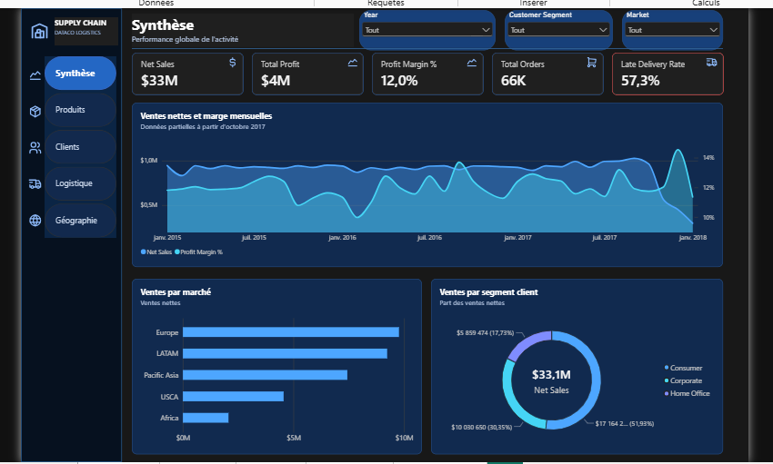
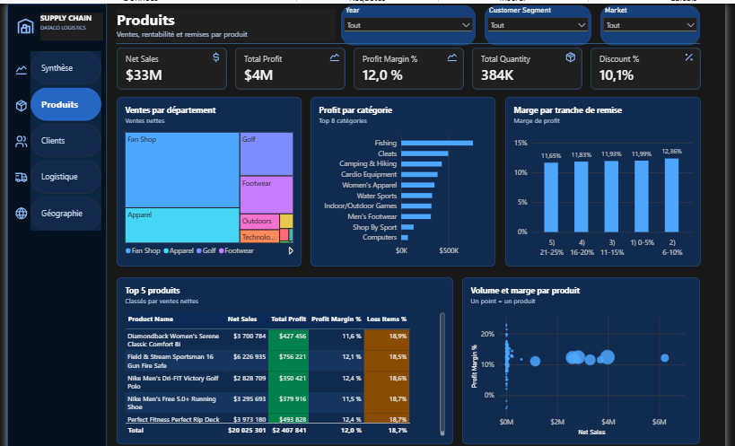
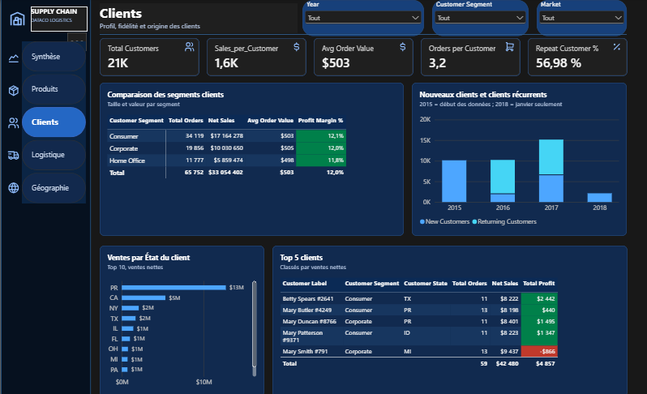
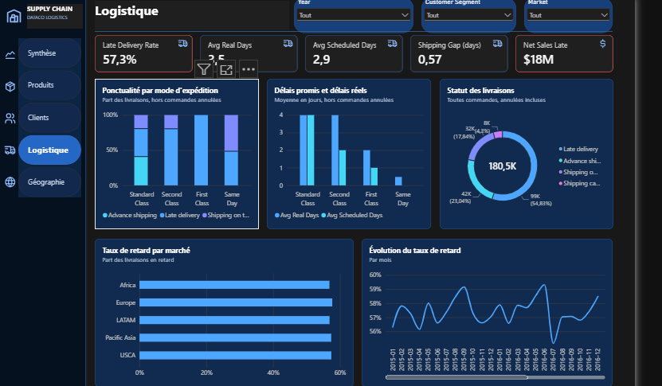
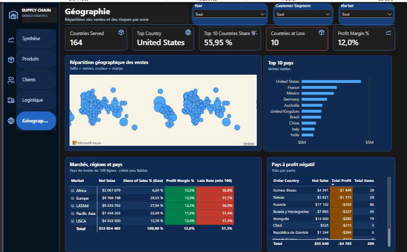
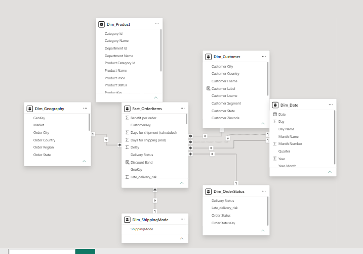

# Supply Chain Analytics – DataCo Logistics

An interactive, French-language Power BI portfolio dashboard for exploring DataCo order, product, customer, logistics, and geographic performance.

[](https://powerbi.microsoft.com/)
[](https://learn.microsoft.com/power-bi/transform-model/desktop-quickstart-learn-dax-basics)
[](https://learn.microsoft.com/power-query/)
[](LICENSE)

## Dashboard preview



## Business context and objectives

The report examines the DataCo Smart Supply Chain order history from 2015 through January 2018. It is designed to help a reader explore:

- How sales, profit, and margin vary over time and across markets.
- Which products and categories contribute to revenue and profit.
- How customer and segment performance differs.
- Where late deliveries and shipping modes create operational concerns.
- Which countries contribute positively or negatively to profit.

## Dashboard pages

The supplied report contains five pages. The metrics are values shown in the dashboard and have not been independently recalculated here.

### 1. Vue d'ensemble


Dashboard-reported headline values: Net Sales **$33M**, Total Profit **$4M**, margin **12.0%**, and approximately **66K orders**.

### 2. Produits



Explore product and category sales, profit, and discount patterns. Dashboard-reported average discount ratio: **10.1%**.

### 3. Clients



Explore customer and segment performance. The report displays approximately **21K customers**.

### 4. Logistique



Explore order status, shipping mode, and delivery performance. The report displays a late delivery rate of **57.3%**; First Class is reported as **100% late** in the supplied dashboard.

### 5. Géographie



Explore markets and country-level sales and profit. The report displays **164 countries** and **10 countries at a loss**; the United States is reported as the leading country.

## Reported observations

These are dashboard observations supplied with the project context, not independent recalculations:

- Late delivery is about **57%** and appears broadly similar across markets, suggesting a widespread operational issue.
- First Class is shown with a **100% late** rate in this report.
- Margin is shown as broadly stable around **12%** across discount bands.
- The United States is shown as the top country, while **10 countries** have negative profit.

Interpret these values in the report's filter context. The KPI definitions and exact measure logic are documented in [the KPI dictionary](docs/kpi-dictionary.md).

## Data model and architecture

The PBIX contains a Power Query source query named `Stg_DataCo` and a semantic model with a central `Fact_OrderItems` table plus date, customer, geography, order status, product, and shipping mode dimensions. The source query references a local CSV path; see [the data notes](data/README.md) and [model notes](docs/data-model.md) before refreshing. A diagram and relationship details are documented only to the extent visible in the supplied model.



## Technology

- Microsoft Power BI Desktop: report and PBIX artifact.
- Power Query M: source query and preparation.
- DAX: semantic model measures.

No SQL, Python, or external ETL scripts were found in the supplied project folder.

## Repository structure

```text
supply-chain-dataco-powerbi/
├── README.md
├── LICENSE
├── .gitignore
├── .gitattributes
├── powerbi/
│   ├── SupplyChainProjectEdition.pbix
│   ├── ReportThemeDark.json
│   └── THIRD-PARTY-NOTICES.md
├── data/
│   ├── README.md
│   └── sample/
├── docs/
│   ├── data-model.md
│   ├── kpi-dictionary.md
│   └── images/
```

## Open and reproduce

1. Install Microsoft Power BI Desktop.
2. Download the source dataset using the instructions in [`data/README.md`](data/README.md), after checking the applicable license and attribution terms.
3. Open `powerbi/SupplyChainProjectEdition.pbix` in Power BI Desktop.
4. If you need to refresh, update the `Stg_DataCo` source path to your local CSV location in Power Query, then refresh the model.

The PBIX is provided as the report artifact. No raw order-level dataset is committed. Refresh behavior has not been validated on another machine.

## Limitations and possible improvements

- Verify the license of the Kaggle copy and record the exact Kaggle attribution.
- Replace the local source path with a configurable parameter before distributing a refreshable PBIP project.
- Validate the reported insights against a reproducible refresh and document the applicable filter context.

## Author

**Nidhal Ghanmi** — Engineering student in ERP and Business Intelligence at ESPRIT, Tunisia.

- GitHub: [Nidhal398](https://github.com/Nidhal398)
- Email: [ghanmi.nidhal@esprit.tn](mailto:ghanmi.nidhal@esprit.tn)
- LinkedIn: [nidhal-ghanmi](https://www.linkedin.com/in/nidhal-ghanmi)

## License and data source

The repository documentation and original project materials are released under the MIT License; this does not relicense third-party data or icons. The dataset is attributed to DataCo and its dataset authors. See [`data/README.md`](data/README.md) for source links, attribution, and license caveats. Tabler icon licensing is included in [`powerbi/THIRD-PARTY-NOTICES.md`](powerbi/THIRD-PARTY-NOTICES.md).
