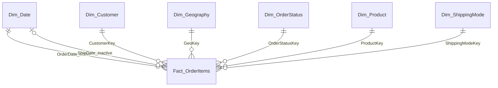

# Data model notes

These notes are based on the semantic model files found in the supplied PBIP project and cross-checked against the delivered PBIX. They document visible model objects only.

## Tables

- `Fact_OrderItems` — order-item facts and measures' source columns.
- `Dim_Date` — calendar dimension.
- `Dim_Customer` — customer dimension.
- `Dim_Geography` — geography dimension.
- `Dim_OrderStatus` — order status dimension.
- `Dim_Product` — product dimension.
- `Dim_ShippingMode` — shipping-mode dimension.
- A hidden local date table is also present in the model.

## Relationships

The fact table is related to the dimensions through shipping mode, product, customer, order status, and geography keys. The active date relationship is `Fact_OrderItems.OrderDate` to `Dim_Date.Date`; the `ShipDate` relationship to `Dim_Date.Date` is inactive.

The diagram summarizes model relationships; cardinality and filter direction beyond those shown by the model are not asserted here.

## Source preparation

The model contains a Power Query M query named `Stg_DataCo` that reads a CSV file. Its current source uses a machine-specific local path. The project files inspected did not contain SQL or Python transformation scripts.

<!-- TODO: à compléter — replace the local source path with a documented parameter or refresh instruction suitable for another machine. -->
